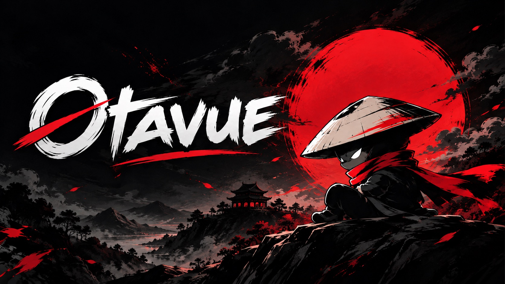
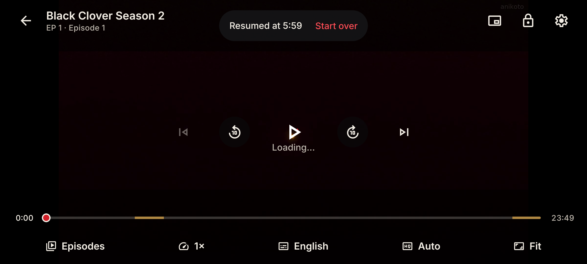
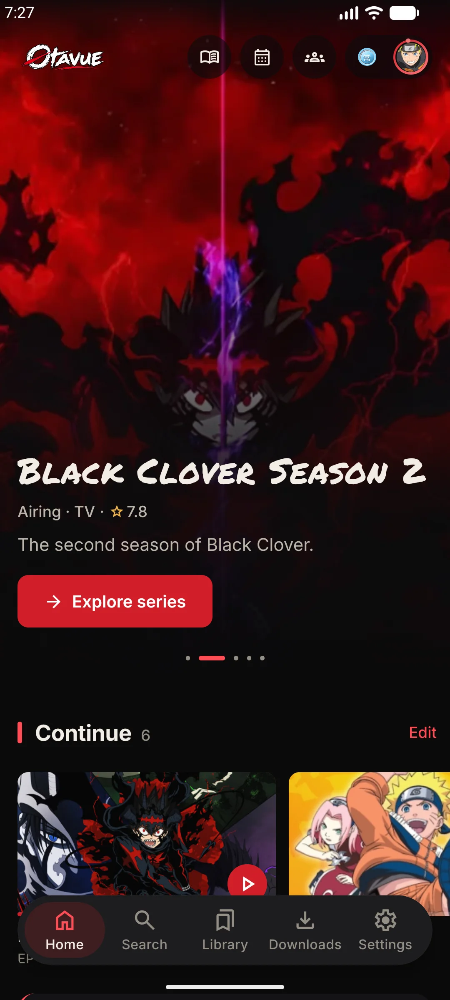
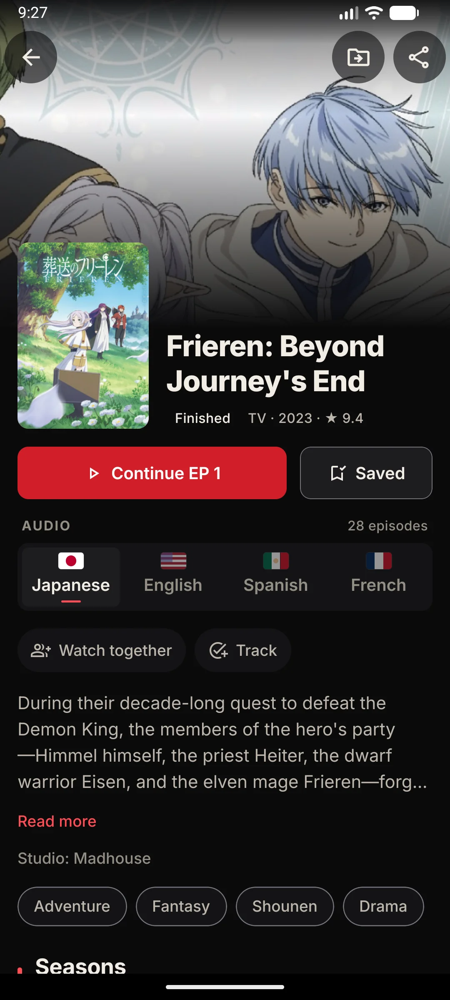
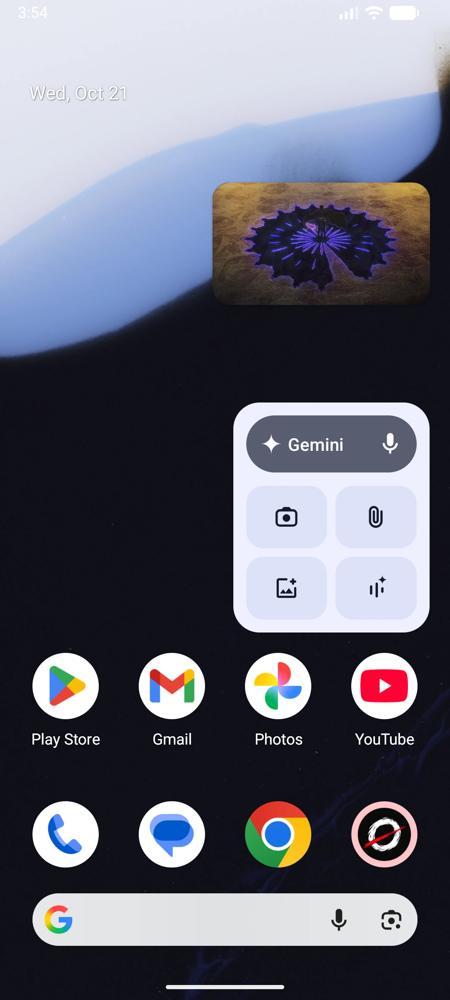
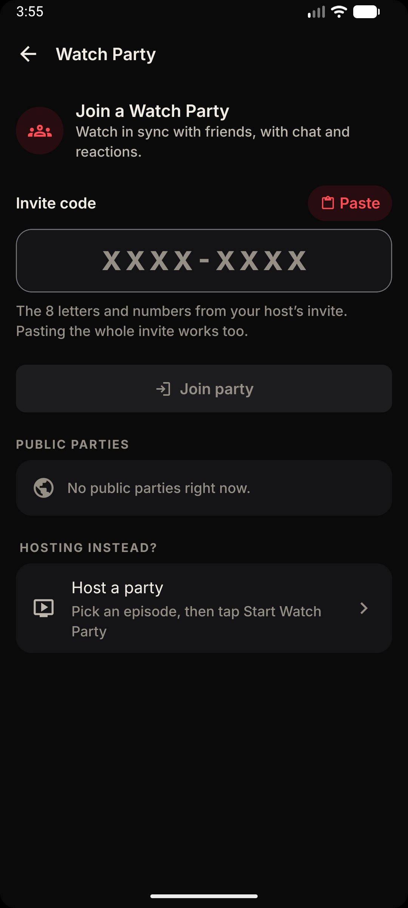
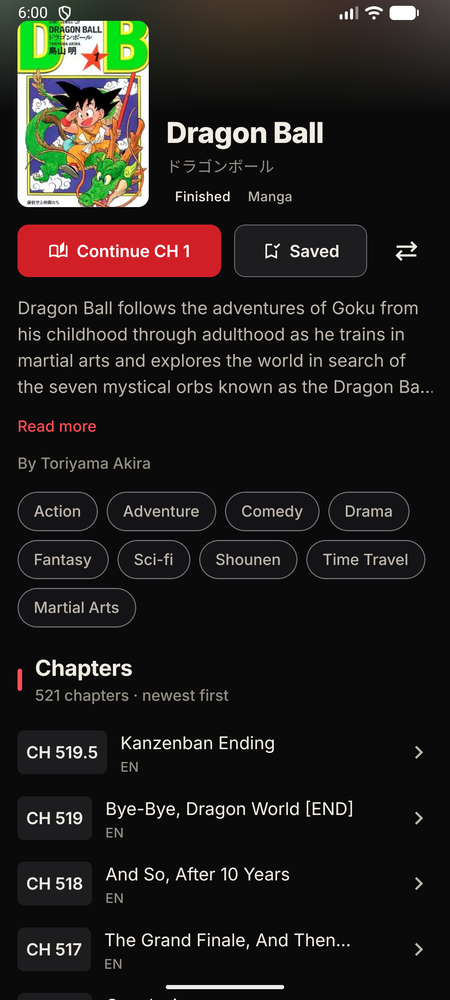
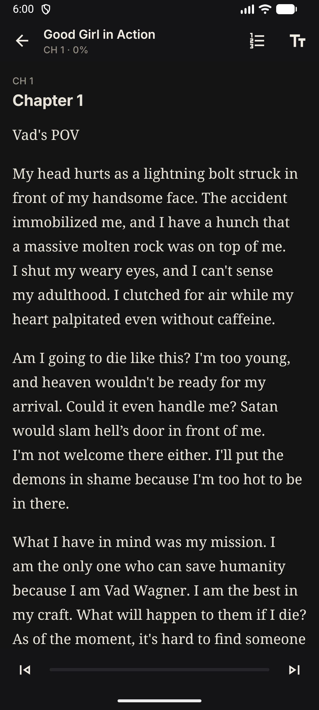
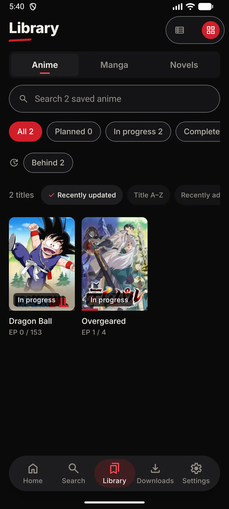
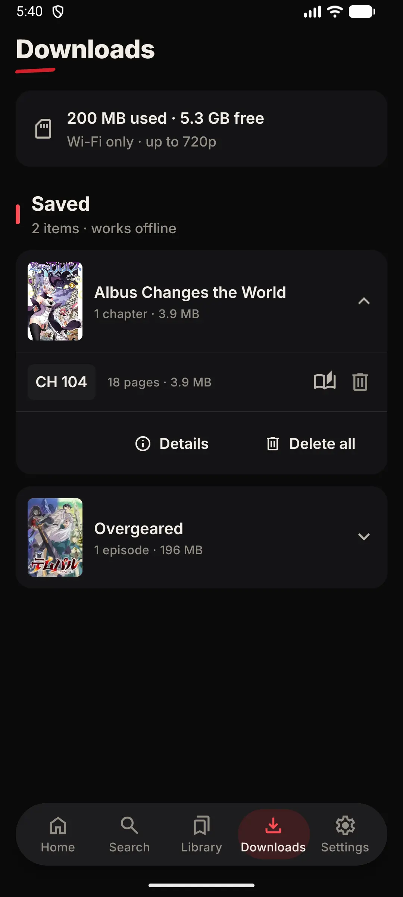

<div align="center">



<h3>The gateway to every story worth watching.</h3>

<p>Stream anime, read the manga and the light novel, and watch with friends, all in one app.<br/>
Free for Android. No account, no ads.</p>

<p>
  <a href="https://otavue-website.vercel.app/download/android"></a>
  <a href="https://github.com/tstar-dev/Otavue-apps/releases"></a>
  <a href="https://github.com/tstar-dev/Otavue-apps/releases"></a>
</p>

<p>
  <a href="https://otavue-website.vercel.app/">Website</a> ·
  <a href="https://otavue-website.vercel.app/features">Features</a> ·
  <a href="https://otavue-website.vercel.app/docs">Install guide</a> ·
  <a href="https://discord.gg/R8XQgANny">Discord</a>
</p>

</div>

---

This repository holds the installable builds of Otavue. Every version is a
[release](https://github.com/tstar-dev/Otavue-apps/releases) with the app
attached; there is no source code here.

## Download

| Platform | Status | Get it |
| --- | --- | --- |
| **Android** (phones and tablets, Android 7.0+) | Available | [Otavue.apk](https://otavue-website.vercel.app/download/android) |
| **Android TV** | Coming soon | — |
| **Windows** | Coming soon | — |

The Download link always points at the newest Android build. Older versions
stay on the [releases page](https://github.com/tstar-dev/Otavue-apps/releases).

### Installing on Android

1. Download `Otavue.apk` on your phone.
2. Open it. If Android asks, allow your browser or file manager to
   **install unknown apps**.
3. Tap **Install**, then open Otavue.

Updates install over the top of the app you have; your library and
downloads stay put.

## What's inside

- **Watch** — a player built around gestures, subtitles, picture-in-picture
  and multiple sources per episode.
- **Read** — manga and light novels next to the anime they come from, with
  your own font, size and theme.
- **Watch parties** — invite friends and stay in sync, episode by episode.
- **Offline** — download episodes, chapters and novels, with a quality cap,
  Wi-Fi only mode and resume on failure.
- **Your list** — AniList and MyAnimeList sync, statuses, favourites, backup
  and restore.

See everything on the [features page](https://otavue-website.vercel.app/features).

## Screenshots

<p align="center"></p>

<table>
  <tr>
    <td align="center"><br/><sub>Home</sub></td>
    <td align="center"><br/><sub>Series</sub></td>
    <td align="center"><br/><sub>Picture-in-picture</sub></td>
    <td align="center"><br/><sub>Watch party</sub></td>
  </tr>
  <tr>
    <td align="center"><br/><sub>Manga</sub></td>
    <td align="center"><br/><sub>Novels</sub></td>
    <td align="center"><br/><sub>Library</sub></td>
    <td align="center"><br/><sub>Downloads</sub></td>
  </tr>
</table>

## Verifying the APK

Every Android release is signed with the same key. To check a download is
genuine, compare its certificate with this SHA-256 fingerprint:

```
AA:98:8D:EB:60:62:9F:97:FE:86:EB:B8:D8:CF:CF:2E:3A:90:89:A7:B4:46:03:5F:D4:FB:9C:03:70:9F:4C:F9
```

```bash
apksigner verify --print-certs Otavue.apk
```

## Help and feedback

Questions, bug reports and ideas are welcome on
[Discord](https://discord.gg/R8XQgANny) or in
[Issues](https://github.com/tstar-dev/Otavue-apps/issues).

<div align="center">
  <br/>
  
</div>
